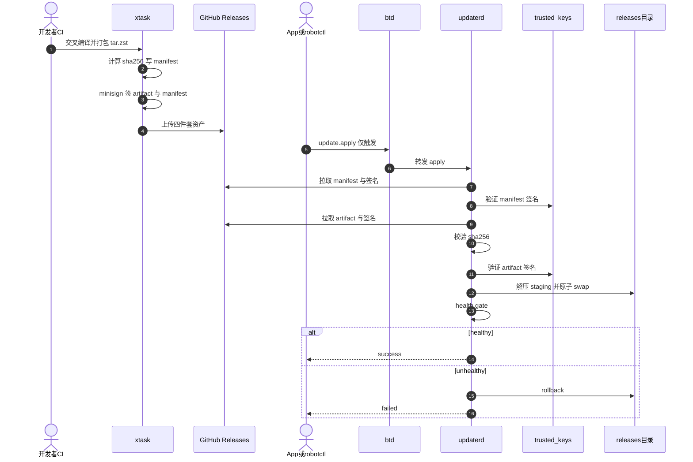
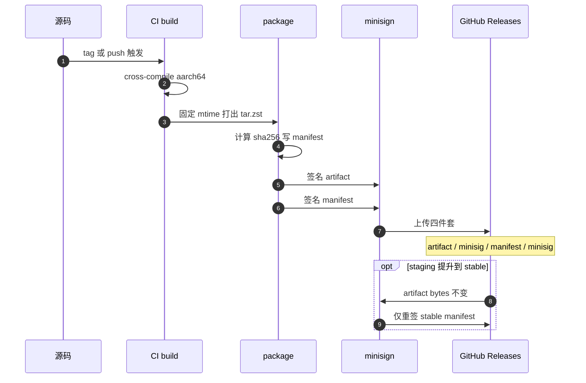
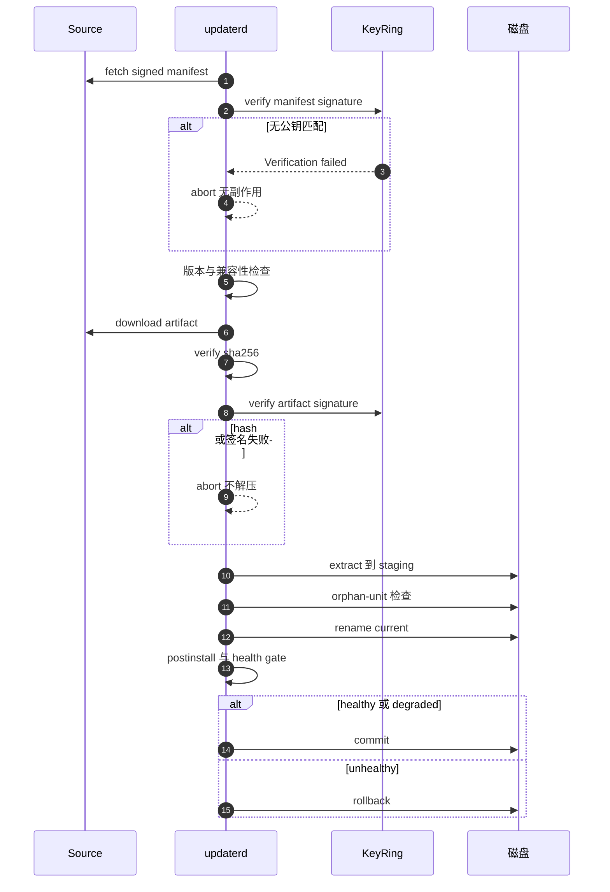
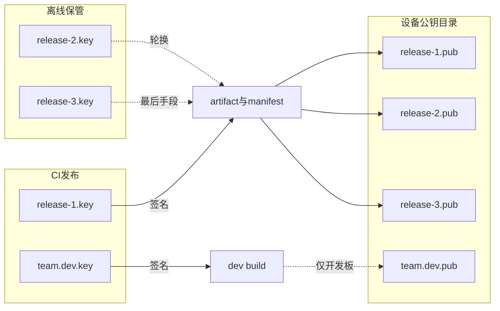

# MicroDuck OTA 数字签名方案调研报告

- **状态：** Draft
- **日期：** 2026-09-01
- **来源：** Pollen Robotics `microduck` 项目
- **参考文档：** `docs/design/updater-design.md` §5.3–5.4、§8.4；`deploy/trusted_keys/README.md`；`updater/src/verify.rs`
- **关联：** OpenEmber [RBU Specification](../../../openember-docs/docs/rbu-specification.md)、[MicroDuck 对 OpenEmber 的启发](../architecture/microduck-lessons-for-openember.md)

---

## 一、结论摘要

MicroDuck 的 OTA 数字签名方案可以概括为：

> **minisign（Ed25519）+ 双对象签名（manifest + artifact）+ 多公钥信任集 + 严格验证顺序 + 无 PKI。**

它不覆盖 OS/内核 OTA，只保护**应用级 release**（daemon 二进制、ML 模型等）。签名证明「这是我们签发的、未被篡改的字节」，**不**证明「这是最新版本」——降级攻击与 freeze 攻击需靠其它机制（见 §八）。

对 OpenEmber RBU 的启示：RBU 1.0 目前以 **SHA-256 完整性**为主；若引入数字签名，MicroDuck 提供了可操作的参考：**manifest 与 artifact 分别签名、信任根为设备侧公钥目录、验证通过后才解压/激活**。

---

## 二、过程总览（时序图）

本节用时序图把「签发 → 打包发布 → 设备验签 → 激活」串成一条可读链路。细节字段与密钥策略见后续各节。

### 2.1 端到端总览



要点：手机 / BLE **只触发**；大包由机器人 HTTPS 自拉；传输层不可信，信任建立在签名与 hash 上。

### 2.2 CI：打包与双签



Promote **不重建** artifact：canary 验过的字节原样进入 stable，只重签指向它的 stable manifest。

### 2.3 设备侧：验签与激活



**不变量：** 未通过「manifest 签 → sha256 → artifact 签」前，**不得**解压到 live 路径或执行 hook。

### 2.4 信任与密钥角色（示意）



量产机默认 `allow_dev_keys=false`，不加载 `*.dev.pub`。

---

## 三、签名算法与格式

| 项目 | 选择 |
| --- | --- |
| 算法 / 工具 | **minisign**（Ed25519 签名） |
| 签名形态 | **Detached signature**（独立 `.minisig` 文件） |
| 机器人侧依赖 | `minisign-verify` crate（**仅验证**，不可签名） |
| CI / 发布侧 | 完整 `minisign` crate（可签名） |
| PKI | **不使用** X.509 / 证书链；信任锚为设备上的公钥文件集 |

设计理由（`updater-design.md` §3）：

- 格式成熟、验证 crate 轻量；
- 密钥管理简单；
- 与「无 fleet 后端、GitHub Releases 拉包」模型匹配。

---

## 四、被签名的对象

每个 release channel（如 `daemon`、`model-walk`）发布时，CI **分别签名**：

1. **Artifact** — 压缩包，例如 `daemon-1.4.2.tar.zst`
2. **Manifest** — JSON 元数据，例如 `manifest.json`

Manifest 示例（节选）：

```json
{
  "channel": "daemon",
  "version": "1.4.2",
  "url": "https://github.com/ORG/REPO/releases/download/daemon-v1.4.2/daemon-1.4.2.tar.zst",
  "sha256": "…",
  "sig_url": "https://github.com/ORG/REPO/releases/download/daemon-v1.4.2/daemon-1.4.2.tar.zst.minisig",
  "min_hw_rev": 3,
  "schema_version": 2,
  "min_supported": "1.5.1"
}
```

GitHub Release 资产通常包含：

```text
daemon-1.4.2.tar.zst
daemon-1.4.2.tar.zst.minisig
manifest.json
manifest.json.minisig
```

HF Hub 上的 model channel：HF **不提供**官方签名，团队自行发布 `.minisig` 并与 artifact 同目录托管。

---

## 五、验证顺序与不变量

`updater/src/verify.rs` 与 `updater-design.md` §5.4 规定：

```text
1. 下载 manifest + manifest.minisig
2. 验证 manifest 签名（任一所信公钥通过即可）
3. 下载 artifact
4. 验证 artifact SHA-256 与 manifest 中声明一致
5. 验证 artifact 签名（任一所信公钥通过即可）
6. 解压到 staging 目录
7. 原子 symlink swap → health gate → 提交或回滚
```

**核心不变量：**

> **No unsigned bytes are ever executed or extracted to a live path.**

即：未通过签名校验与 hash 校验的字节，**不得**解压到 live 路径或执行。`postinstall` hook 虽在 tarball 内，但 tarball 整体已签名，故 hook 代码仍受 artifact 签名保护。

---

## 六、信任锚：多公钥目录

### 6.1 设备侧布局

```text
/etc/robot/trusted_keys/
├── release-1.pub    # 当前 CI 签名用
├── release-2.pub    # 轮换备用 1
└── release-3.pub    # 轮换备用 2（私钥 ideally 永不上联网机器）
```

配置项（`updater.toml`）：

```toml
trusted_keys_dir = "/etc/robot/trusted_keys"
allow_dev_keys = false   # 量产机默认 false
```

**验证规则：**

- 加载目录下所有 `*.pub`；
- 签名只要被**任意一把**可用公钥验证通过即接受；
- 空 keyring **直接拒绝启动**（不能「静默信任为空」）；
- 记录**哪把 key** 通过了验证（便于审计与退役旧 key）。

### 6.2 密钥分级与保管

| 密钥 | 加密 | 私钥存放 | 是否进 CI | 机器人信任集 |
| --- | --- | --- | --- | --- |
| `release-1` | 是 | 密码管理器 + CI secrets | 是 | 全部量产机 |
| `release-2` | 是，**不同口令** | 仅密码管理器，**不进 CI** | 否 | 全部量产机 |
| `release-3` | 是 | 离线 | 否 | 全部量产机 |
| `team.dev` | 否 | 团队存储 + CI（仅 dev workflow） | dev 分支构建 | **仅开发板**（`allow_dev_keys=true`） |

关键设计点：

1. **备用公钥必须从首版镜像就烧进设备** — 机器人只能验证镜像里已有的公钥集；丢失唯一私钥后无法 OTA 注入新公钥，只能返厂重刷。
2. **备用密钥口令与暴露面必须不同** — `release-1` 在 CI 中是必然暴露面，`release-2` 不能与之同口令、同存放。
3. **公钥可提交仓库** — `deploy/trusted_keys/*.pub` 公开；私钥在 `~/.duck-keys` 与 CI secrets。
4. **Dev key 隔离** — 文件名含 `.dev.` 后缀；仅 `allow_dev_keys=true` 时参与验证；客户机默认拒绝 dev 签名包。

生成命令：

```bash
cargo xtask keygen --kind release --name release-4 --out ~/.duck-keys
```

---

## 七、CI 签名与发布流程

### 7.1 工作流分工

| 触发 | Workflow | 签名密钥 | 是否到达客户机 |
| --- | --- | --- | --- |
| 任意分支 push | `dev.yml` | `team.dev` | 否 |
| tag `daemon-staging-v*` | `release.yml` | `release-1` | 否（prerelease，需 canary） |
| 手动 promote | `promote.yml` | `release-1` | 是（stable） |

### 7.2 发布步骤（`release.yml` 概念）

1. 交叉编译并打包 artifact（`tar.zst`，固定 mtime 保证可重现 hash）
2. `minisign -S` 签名 artifact 与 manifest
3. 发布到 GitHub Releases（staging）
4. **发布前自测：** 用真实 `updaterd` 引擎安装验证（`install --from`），确保机器人侧可接受
5. Canary 验证后 **promote**：stable manifest **重新签名**，但 **artifact bytes 不变**（同一 sha256）

### 7.3 工具链一致性

`xtask` 发布工具与 `updaterd` 使用**同一套** `minisign` / `tar` / `zstd` / `sha2` crate，避免「CI 签出来的包机器人验不过」。

- `updaterd` → `minisign-verify`（不能签）
- `xtask` → 完整 `minisign`（能签）

---

## 八、签名能防什么、不能防什么

### 8.1 能防

| 威胁 | 机制 |
| --- | --- |
| 篡改 artifact / manifest | Ed25519 + SHA-256 |
| 安装非官方包 | 无匹配公钥则拒绝 |
| 执行未签名 hook / 二进制 | 整体 tarball 已签名，未验签不解压 |

### 8.2 不能单独防（需额外机制）

| 威胁 | 说明 | MicroDuck 对策 |
| --- | --- | --- |
| **Downgrade（回滚到旧版 signed release）** | 旧 manifest 仍有效签名 | `Target::Latest` 拒绝比已安装更旧的版本；显式 `--version` 才允许 |
| **Freeze（永远提供当前 manifest）** | 签名仍有效，但看不到新版本 | **未完全解决**；推荐 staleness 上报；未来可选 `not_valid_after` |
| **Stolen signing key** | 攻击者可签恶意包 | 多 key 轮换 + `release-2/3` 离线备用；fleet 强制 `min_supported` 拉新版本 |
| **Replay signed manifest** | 与 downgrade 类似 | 版本比较 + `from_release` 语义 |

文档原话（§8.4）：

> A minisign signature proves an artifact **came from us and wasn't modified**. It says nothing about *when* it was published or whether it is still current.

---

## 九、与传输层的关系

- **Robot 自行 HTTPS 拉包**（GitHub Releases / HF Hub）；手机 BLE **只触发**，不传 payload。
- 传输层（CDN、DNS、中间人）**不可信**；信任完全建立在签名 + hash 上。
- 私有 GitHub 仓库：asset URL 对无 token 客户端 404，需 API + token（开发板）；**公开 repo** 后客户机无需 token。
- 本地 sideload（`robotctl update apply --from <dir>`）：同样走完整验签流程，**不**因「本地目录」跳过签名。

---

## 十、与 OpenEmber RBU 的对照

| 维度 | MicroDuck | OpenEmber RBU 1.0（当前） |
| --- | --- | --- |
| 包格式 | 单 channel tarball + manifest.json | `.rbu`（manifest.json + artifacts/） |
| 完整性 | SHA-256 + minisign | **SHA-256**（§13） |
| 真实性 / 签名 | minisign 双签 | **Draft 未定义**（§13.2 预留 manifest.sig） |
| 信任根 | `/etc/robot/trusted_keys/` 多公钥 | 未定义 |
| 激活 | symlink swap + health gate | `reboot_after` + Handler（实现待定） |
| 范围 | 应用 release，不 OTA OS | 多组件（Linux Image、openember 包、MCU 固件等） |

RBU 文档已预留扩展布局：

```text
bundle.rbu
├── manifest.json
├── manifest.sig      # 未来
└── artifacts/
```

### 10.1 可借鉴的 RBU 签名设计要点

1. **Manifest 与每个 Artifact 分别签名**（或 manifest 内嵌 artifact hash + 对 manifest 签名，MicroDuck 是两者都签）
2. **设备侧公钥集**，非单 key；首版镜像写入全部备用公钥
3. **验证顺序写进规范**：验签 → hash → 解压/安装
4. **Dev / Release 密钥分离**，产品机默认只信 release key
5. **记录 signing key id** 到升级日志，便于 key 轮换审计
6. **签名 ≠ 防 downgrade** — RBU 需单独定义 `from_release`、最低版本 floor、manifest 时效等

---

## 十一、实现参考路径

| 组件 | MicroDuck 路径 |
| --- | --- |
| 验证逻辑 | `updater/src/verify.rs` |
| 密钥环 | `KeyRing::load()` / `verify_bytes()` / `verify_file()` |
| 信任公钥 | `deploy/trusted_keys/` |
| 发布签名 | `xtask/src/main.rs` |
| 测试 | `updater/tests/apply.rs`（wrong-key、hash mismatch、downgrade 等） |
| 设计权威页 | `docs/design/updater-design.md` §5.4、§8.4 |

---

## 十二、摘要

```text
算法：     minisign (Ed25519)
对象：     manifest.json + artifact (.tar.zst)
形态：     detached .minisig
信任根：   /etc/robot/trusted_keys/*.pub（多 key，任一匹配）
顺序：     manifest 签 → 下载 → sha256 → artifact 签 → 解压
隔离：     release key（量产） vs team.dev（开发板）
CI：       release-1 签 stable；team.dev 签分支；promote 不重建 artifact
边界：     签名保证真实性与完整性；不保证「最新」；OS OTA 不在范围
```

MicroDuck 的签名方案刻意保持**简单、可审计、可轮换**，把复杂度留给 OTA 状态机（health gate、golden、boot rescue）而非 PKI。OpenEmber 若在 RBU 1.x 引入签名，建议沿用「双对象签名 + 多公钥目录 + 严格验签顺序」，并与现有 `sha256` 字段兼容共存。
